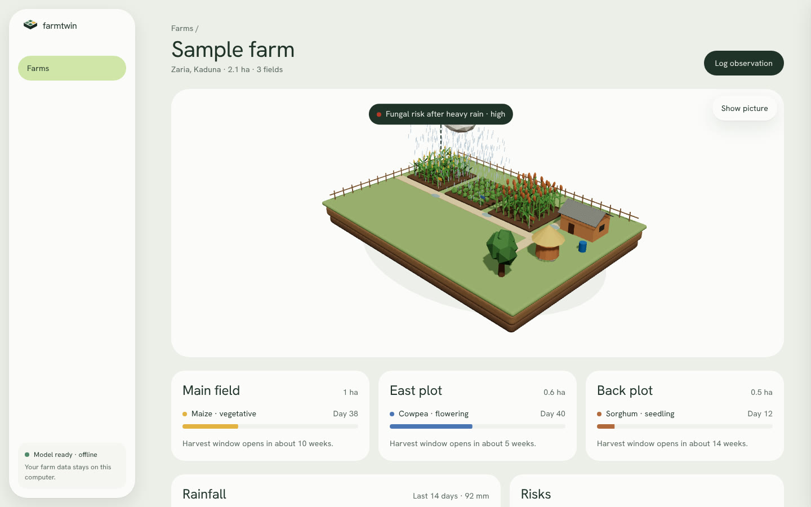
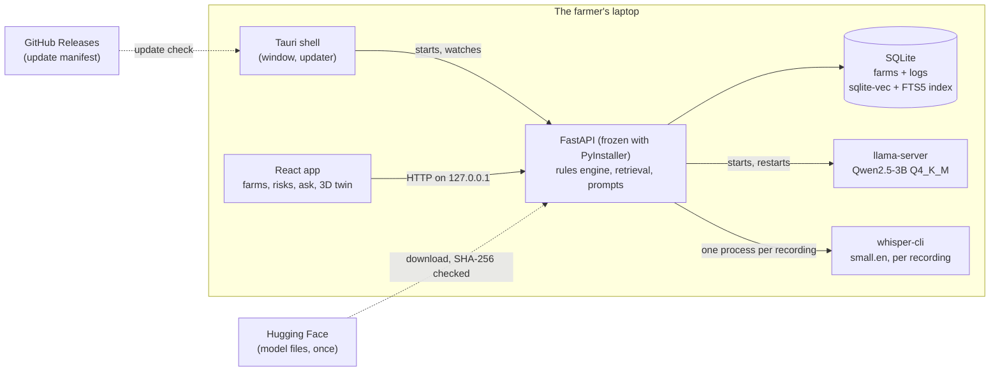

# FarmTwin

A desktop app for Nigerian smallholder farmers and extension officers: it keeps a record of each farm, works out crop stage and risk from what you log, and answers questions from extension guides with a language model that runs on the laptop, without internet.



**Website and docs:** [farmtwin-beta.vercel.app](https://farmtwin-beta.vercel.app) · **Installers:** [Releases](https://github.com/Elisabeth56/FarmTwin/releases) (first release pending) · **Case study:** [docs/case-study.md](docs/case-study.md) · **v1 demo video:** [YouTube](https://youtu.be/j7z2c7UC6_I)

## The problem

Extension advice in Nigeria lives in PDFs and in the heads of extension officers, and each officer covers many farms. Generic advice ("spray when you see armyworm") doesn't say what to do on *this* farm *this* week. Chat assistants that could do that need a data connection and a paid API, which many farmers and officers don't have reliably.

## What it does

- **Keeps a twin of every farm.** Fields, plantings (more than one per field, for intercropping), rain, humidity, pests and notes. Six crops: maize, cassava, yam, sorghum, rice and cowpea.
- **Works out stage and risk in code.** Crop calendars and risk rules are YAML files, and each rule names its source. Log 65 mm of rain on young maize and the fungal-risk card appears, with the rule that fired.
- **Answers questions about this farm.** "What should I do this week?" gets an answer that uses the farm's stages, recent logs and open risks, cites the guide passages it used, and says when the guides don't cover the question. English or Pidgin in, English out.
- **Runs offline after setup.** The model (2.1 GB) is downloaded once or imported from a flash drive, and both paths check its SHA-256. Voice input is an optional 190 MB extra.
- **Shows the farm in 3D**, drawn from its real plantings, with rain and the top risk on it.

## How it works



1. The Tauri shell starts the API on a free port and passes it the paths of the bundled llama-server, whisper-cli and embedder. If the shell goes away, the API notices and exits.
2. Logging an observation recomputes each planting's stage and risks from the crop rule files. No model is involved.
3. A question runs hybrid retrieval (vector + full-text, merged with reciprocal rank fusion) filtered to the farm's crops. If the closest passage is too far away, the app says the guides don't cover it instead of guessing.
4. The prompt gets the farm state, the open risks and the numbered passages. The answer streams back, and citations that don't match a retrieved passage are dropped.

## Engineering decisions

Each has a decision record in [docs/decisions](docs/decisions).

- **One SQLite file for everything** ([ADR-013](docs/decisions/0013-sqlite-single-file-store.md)). Farm data, the vector index (sqlite-vec) and full-text search (FTS5) live in one file. A separate vector database would be a second process to ship and keep in sync on a laptop with 8 GB of RAM.
- **Rules in data, model for explanations** ([ADR-019](docs/decisions/0019-crop-knowledge-as-data.md)). Stages, thresholds and dates are computed in Python from YAML. The model explains results it's given and never does the arithmetic. This keeps risk cards reproducible and testable.
- **A relevance cutoff instead of always answering** ([ADR-018](docs/decisions/0018-hybrid-retrieval-with-cutoff.md)). The cutoff (0.78) sits between the closest-passage distance of answerable eval questions (0.63 on average) and unanswerable ones (0.87).
- **The API owns llama-server** ([ADR-027](docs/decisions/0027-api-supervises-llama-server.md)). The "model stopped" screen and its Restart button work the same in development and in the installed app, and are covered by pytest.
- **Model by download or import, always checked** ([ADR-023](docs/decisions/0023-model-download-and-import.md)). Downloads resume with HTTP Range requests; an imported file is hashed before it's copied, so a wrong or damaged file never lands.

## AI quality

`evals/` holds a 51-question golden set across the six crops, Pidgin phrasings, intercropped farms and questions the guides can't answer. Retrieval is measured on every CI run; answers are judged by a separate model against key facts and the retrieved context.

Retrieval, from [evals/results/baseline-retrieval.json](evals/results/baseline-retrieval.json) (bge-small-en-v1.5, top 6):

| Metric | Value |
|---|---|
| Right source in top 6 | 100% |
| Expected sources found (recall@6) | 98.1% |
| MRR (source) | 0.967 |
| Right passage first | 82.2% |
| Latency p50 / p95 | 5.2 ms / 6.7 ms |

The answer eval hasn't been run on the v2 prompts with the real model yet; the harness runs end to end in CI against a stand-in model. The v1 build (maize only, a different prompt) scored 87.6/100 on 10 prompts and peaked at 3.06 GB of memory on a 2014 MacBook Pro with 8 GB, measured during the hackathon ([benchmarks](docs/v1/benchmarks.md)).

## Tech stack

- **Desktop:** Tauri v2, because it ships a small native shell with an updater on all three systems. The API runs next to it, frozen with PyInstaller so the laptop needs no Python.
- **App UI:** React 19, Vite, Tailwind v4, Three.js for the farm (loaded only when you open the 3D view).
- **Backend:** FastAPI, SQLAlchemy 2, Alembic migrations run at startup.
- **Data:** SQLite with sqlite-vec and FTS5.
- **AI:** llama.cpp's llama-server with Qwen2.5-3B Instruct Q4_K_M; fastembed (ONNX) with bge-small-en-v1.5, bundled in the installer; whisper.cpp for voice.
- **Website:** Astro and Starlight on Vercel.
- **CI:** GitHub Actions: lint, types, tests, retrieval eval, installer builds for Windows, Intel and Apple Silicon Macs and Linux.

## Run locally

You need Python 3.11 or 3.12 with [uv](https://docs.astral.sh/uv/), Node 22 with pnpm, and a llama-server build.

```bash
pnpm install
cd apps/api && uv sync && uv run python scripts/fetch_embedder.py && cd ../..
pnpm dev     # app on http://127.0.0.1:5173, API on :8000
```

Start llama-server yourself with the model on port 8080, or let the API manage it:

```bash
FARMTWIN_LLAMA_SERVER_BIN=/path/to/llama-server pnpm dev:api
```

Without a model, `FARMTWIN_LLAMA_SERVER_BIN=scripts/fake_llama.sh` streams a fixed answer, which is enough to work on the UI. Tests: `cd apps/api && uv run pytest`, `pnpm --filter @farmtwin/web test`. To build an installer for your system, see [apps/desktop/README.md](apps/desktop/README.md).

## Repository

```
apps/web        React app
apps/api        FastAPI backend, rules engine, retrieval, prompts
apps/desktop    Tauri shell and installer build
apps/site       website and docs
packages/twin   the 3D farm, shared by the site and the app
knowledge       corpus (with SOURCES.md) and crop rule files
evals           golden set, retrieval and answer evals, results
docs            architecture, decisions, frozen v1 documents
```

## Limitations and next steps

- **Installers are unsigned**, so Windows and macOS warn on first open; the [install guide](https://farmtwin-beta.vercel.app/docs/install/) shows the way past it.
- **Not yet measured on v2:** answer quality, speed and memory with the real model, and voice accuracy on Nigerian-accented speech. Those numbers come from a run on real hardware, not from here.
- **The maize corpus from v1** cites publishers, not specific documents. [knowledge/SOURCES.md](knowledge/SOURCES.md) lists each one; they need tracing or replacing.
- Voice is English only. Hausa, Yoruba and Igbo, and a phone app, are out of scope for now ([ADR-025](docs/decisions/0025-languages-and-mobile.md)).

FarmTwin began as an entry to the [Africa Deep Tech Challenge 2026](https://africadeeptechchallenge.com/) (Laptop LLM, Agriculture); the hackathon documents are frozen in [docs/v1](docs/v1).

## Author

Elisabeth Nnamani · [GitHub](https://github.com/Elisabeth56)

MIT licence. Agricultural content belongs to its publishers; see [knowledge/SOURCES.md](knowledge/SOURCES.md).
