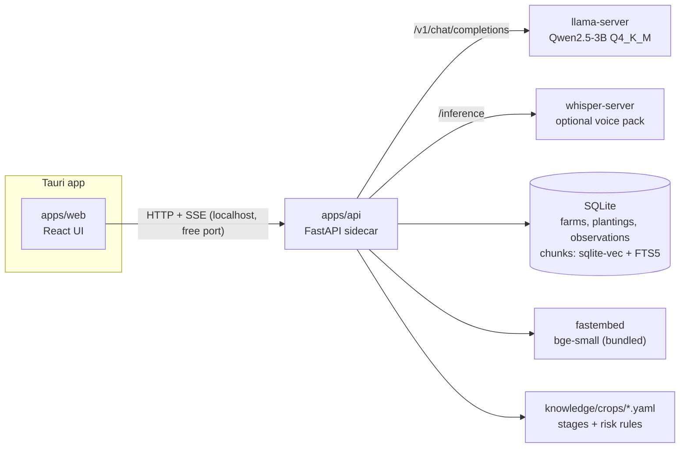

# FarmTwin v2 architecture

FarmTwin is an offline desktop assistant for Nigerian extension officers and smallholder farmers. It tracks farms, computes crop stage and risk with deterministic rules, and answers questions with a local LLM grounded in a curated agricultural corpus. After setup, nothing needs the internet.

## Processes



Tauri starts the FastAPI sidecar, reads the port it chose, waits for `/api/health`, then loads the UI. FastAPI runs migrations, then starts llama-server (and whisper-server if a voice model is installed). All sidecars stop when the window closes.

## Data

```
farms 1─* fields 1─* plantings          (many active plantings per field: intercropping)
fields 1─* observations                 (rainfall, humidity, temperature, pest, disease, note)
farms  1─* weather_snapshots
farms  1─* recommendations              (cited chunk ids, model, prompt version)
documents 1─* chunks                    (+ chunks_vec, chunks_fts)
```

Derived on read, never stored: growth stage, days since planting, harvest window, active risks.

File locations (OS app data folder): `farmtwin.db`, `models/*.gguf`, `logs/`.

## Ask flow

1. Load the farm, its fields, active plantings, last 30 days of observations, latest weather.
2. Compute stage and evaluate risk rules from the crop YAML files.
3. Build a retrieval query; run hybrid search filtered by crop.
4. Below the relevance cutoff: return "not in my sources" without calling the LLM.
5. Otherwise: assemble the prompt from `ai/prompts/`, stream from llama-server.
6. Validate the trailing recommendations block; one repair retry; persist.

## Distribution

- GitHub Actions builds Windows x64, Linux x64, macOS x64 and macOS arm64 on tag.
- Installers go to GitHub Releases. The site's download page reads the latest release.
- Models: downloaded or imported on first run, checked by SHA-256.
- Updates: Tauri updater, signed with its own key. No paid OS code signing.

## Decisions

v1: ADR-001 to ADR-012 (hackathon build). v2: ADR-013 to ADR-026 in `docs/decisions/`.
