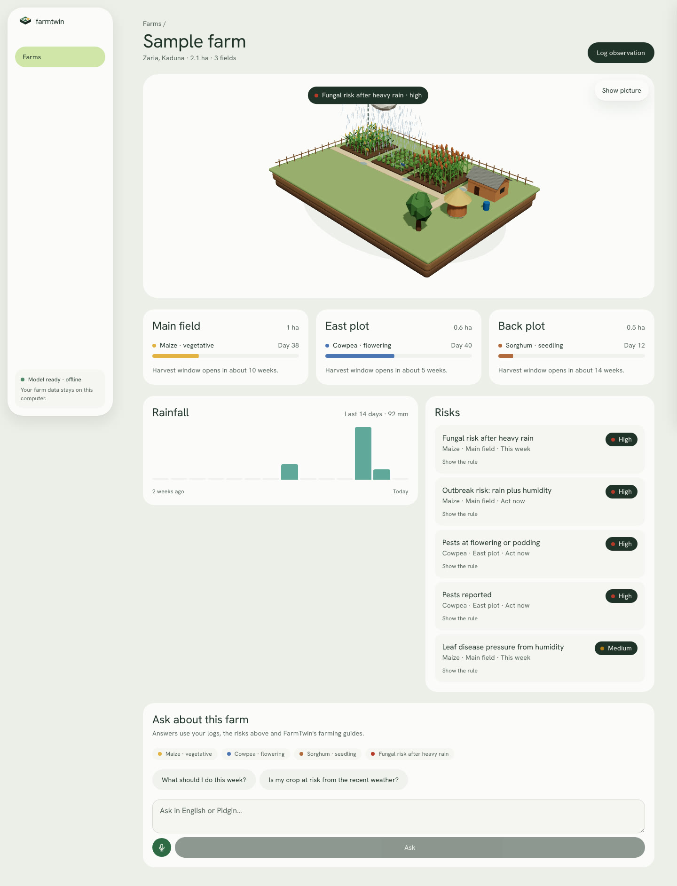

# FarmTwin: farm advice that runs on the laptop

*Draft case study. Numbers marked v1 come from the hackathon build; v2 model numbers are still to be measured.*

## Context

FarmTwin is a desktop app for smallholder farmers and extension officers in Nigeria. It keeps a record of each farm, works out crop stage and risk from what's logged, and answers questions from extension guides with a language model that runs on the laptop. I built the first version in seven days for the Africa Deep Tech Challenge 2026, then rebuilt it as something a farmer could install.

## The problem and the constraints

An extension officer looks after many farms. The guidance they rely on sits in long PDFs from IITA, ICRISAT and others, and it's written for a crop, not for a farm. "Watch for fungal disease after heavy rain" is only useful if someone notices that this field had 65 mm of rain on Tuesday and the maize is six weeks old.

The constraints shaped every decision:

- **No internet at the point of use.** The challenge enforced it with an airplane-mode test, and it matches how the app gets used: in the field, on an old laptop.
- **8 GB of RAM, no GPU.** The model, embedder, database and UI share one modest machine, with a 7 GB ceiling.
- **No budget.** No paid APIs or code signing.
- **Advice has to be traceable.** A wrong spraying recommendation costs a harvest, so every answer cites its sources, and the app says so when the guides don't cover a question.

## Approach

**Rules decide, the model explains.** I kept the language model away from anything that can be computed. Crop calendars and risk rules are YAML files: stage lengths per crop, and conditions like "a rainfall log of 50 mm or more in the last five days while maize is vegetative", each naming its source. Python evaluates them on every log. The model gets the results as facts and its job is to explain them and turn them into a plan. Risk cards are reproducible and unit-tested, and the model never does date arithmetic.

**Retrieval that can say "I don't know".** The corpus is paraphrased passages from extension guides for six crops, each with a source ID listed in `knowledge/SOURCES.md`. Search is hybrid: sqlite-vec for meaning and SQLite full-text search for exact pest and variety names, merged with reciprocal rank fusion and filtered to the farm's crops. I built a 51-question golden set, including questions the guides can't answer, and used it to set a cutoff: answerable questions found a passage at distance 0.63 on average, unanswerable ones at 0.87, so anything beyond 0.78 gets a "not in my guides" answer instead of a guess. The right source is in the top six for every question in the set, and the right passage comes first 82% of the time.

**One file, one process tree.** Farm data, vectors and full-text search live in a single SQLite file. The Tauri shell starts the API; the API starts llama-server and restarts it if it dies, which let me build the "model stopped" screen and its Restart button once and test it with pytest. Voice uses whisper.cpp as a process per recording, so the voice model is only in memory while it's transcribing.

**Getting a 2 GB model onto a laptop with bad internet.** The installer stays small and the model comes separately: a download that resumes where it stopped, or an import from a flash drive, for when one officer downloads it and copies it to the rest. Both paths check the file's SHA-256 before it's used.

**A farm you can see.** The farm screen draws the farm's own plots in 3D, with rain when the logs say it rained and a badge on the plot with the most urgent risk. It's the same Three.js scene as the website's hero, shared as a workspace package, and in the app it only renders while something moves.

## Results

- **Retrieval:** 100% of questions have the right source in the top six, recall@6 is 98.1%, and search takes 6.7 ms at p95.
- **v1 answers:** 87.6/100 on ten judged prompts, with peak memory of 3.06 GB on a 2014 MacBook Pro with 8 GB. That build covered maize only and used a different prompt.
- **v2:** installers for Windows, Intel and Apple Silicon Macs and Linux build in CI. Answer quality, speed and memory for v2 still need a run on real hardware.

## What I learned

Silent failures were the expensive ones. Two corpus passages had a stray colon in their frontmatter and the parser skipped them without a word, so search just quietly knew less. The parser fails loudly now, and the eval set is what tells me whether a corpus change helped or hurt.

Keeping the model out of the arithmetic made the whole system easier to trust and to test. Most of the "intelligence" a farmer sees, the stage, the risk and the timing, is ordinary code with a source next to every threshold.

Next: run the answer eval and the memory benchmark on the target laptop, trace the v1 maize sources to specific documents, and convert a Nigerian-accent Whisper fine-tune for voice once it can be measured against the stock model.
